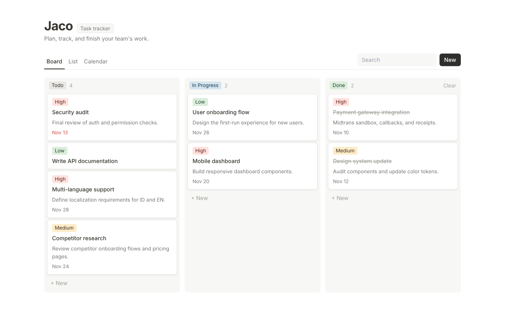

# Jaco

Jaco adalah aplikasi task tracker sederhana. Bisa tambah task, ubah status (Todo, In Progress, Done), atur priority dan due date, lalu hapus task yang sudah selesai. Task bisa dilihat dalam tampilan Board, List, atau Calendar.




## Tech Stack

- Backend: Python, FastAPI, SQLAlchemy, Pydantic
- Database: PostgreSQL
- Frontend: React (Vite), axios, Tailwind CSS

## Fitur

Backend
- Endpoint `GET /tasks`, `POST /tasks`, `PUT /tasks/{id}`, `DELETE /tasks/{id}`
- Tabel dibuat otomatis saat server dijalankan (`create_all()`)
- Validasi input: judul tidak boleh kosong, status hanya Todo / In Progress / Done
- CORS aktif untuk frontend
- Konfigurasi database diambil dari file `.env`

Frontend
- Menampilkan daftar task dari API
- Form tambah dan edit task tanpa reload halaman
- Ubah status lewat dropdown, menu, atau drag & drop di Board
- Tombol hapus task
- Data di layar langsung ter-update setelah tambah, ubah, atau hapus
- Tampilan responsif (desktop dan mobile)

## Struktur Folder

```
jaco-task-tracker/
├── backend/
│   ├── main.py            # semua kode backend
│   ├── tests/             # test API
│   ├── requirements.txt
│   └── .env.example
├── frontend/
│   ├── src/
│   │   ├── api/           # request ke backend (axios)
│   │   ├── hooks/         # state task
│   │   ├── components/    # tampilan Board, List, Calendar, form
│   │   └── App.jsx
│   ├── package.json
│   └── .env.example
└── docs/                  # screenshot
```

## Cara Menjalankan

Yang perlu ada: Python 3.9+, Node.js 18+, dan PostgreSQL.

### 1. Clone repo

```bash
git clone https://github.com/cindykhoe06/jaco-task-tracker.git
cd jaco-task-tracker
```

### 2. Buat database

```bash
createdb task_tracker
```

Atau lewat psql: `CREATE DATABASE task_tracker;`

Tabelnya tidak perlu dibuat manual, nanti dibuat otomatis oleh backend.

### 3. Jalankan backend

```bash
cd backend
python3 -m venv .venv
source .venv/bin/activate        # Windows: .venv\Scripts\activate
pip install -r requirements.txt
cp .env.example .env
```

Isi `.env` sesuai PostgreSQL masing-masing:

```
DB_HOST=localhost
DB_PORT=5432
DB_USER=postgres
DB_PASSWORD=password_kamu
DB_NAME=task_tracker
CORS_ORIGINS=http://localhost:5173
```

Lalu jalankan:

```bash
uvicorn main:app --reload --port 8000
```

Backend jalan di http://localhost:8000. Dokumentasi API bisa dicoba di http://localhost:8000/docs.

### 4. Jalankan frontend

Buka terminal baru:

```bash
cd frontend
cp .env.example .env
npm install
npm run dev
```

Buka http://localhost:5173.

## API

| Method | Endpoint      | Keterangan          |
| ------ | ------------- | ------------------- |
| GET    | `/tasks`      | Ambil semua task    |
| POST   | `/tasks`      | Tambah task         |
| PUT    | `/tasks/{id}` | Ubah task           |
| DELETE | `/tasks/{id}` | Hapus task          |

Contoh body untuk `POST /tasks`:

```json
{
  "title": "Setup database",
  "description": "Buat database PostgreSQL",
  "status": "Todo"
}
```

Field tambahan yang opsional: `priority` (`Low` / `Medium` / `High`) dan `due_date` (format `YYYY-MM-DD`).

Kalau data tidak valid (misalnya judul kosong atau status salah), API membalas `422`. Kalau id tidak ditemukan, API membalas `404`.

## Test

```bash
createdb task_tracker_test
cd backend
pip install -r requirements-dev.txt
DB_NAME=task_tracker_test pytest -v
```

## Kendala yang Mungkin Muncul

- `role "postgres" does not exist`: biasanya terjadi kalau PostgreSQL diinstal lewat Homebrew. Ganti `DB_USER` di `.env` dengan username laptop.
- Frontend tidak bisa ambil data: pastikan backend sudah jalan di port 8000.
- Error CORS: pastikan alamat frontend sudah ada di `CORS_ORIGINS` pada `.env` backend.